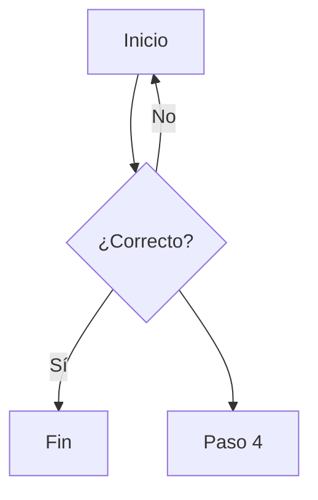

$$
\begin{pmatrix} &  &  &  & \\  &  &  &  & \\  &  & 6 &  & 6\\  &  &  &  & \\  & 6 &  &  & 6\end{pmatrix}
$$

# 📗 Módulo 2

[Introducción](./contenidos/introduccion)

::::: tabs
== Pestaña 1
Contenido de la primera pestaña.

== Pestaña 2
Contenido de la segunda pestaña.

:::: accent-box ✨ Idea clave
Escribe aquí el contenido.

::: accent-box ✨ Idea clave
Escribe aquí el contenido.
:::
::::
:::::

::: accent-box info ✨ Idea clave
Escribe aquí el contenido.
:::
